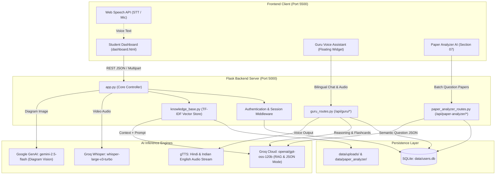

# 📚 Bharat Study Buddy

**An Intelligent AI-Powered Multimodal Academic Companion for Students**

[](https://www.python.org/)
[](https://flask.palletsprojects.com/)
[-orange.svg)](https://groq.com/)
[-4285F4.svg?logo=google&logoColor=white)](https://ai.google.dev/)
[](https://www.sqlite.org/)
[](LICENSE)

---

## 📌 1. Project Overview

**Bharat Study Buddy** is an end-to-end AI study platform designed to help college and school students master complex academic subjects, prepare for university semester exams, and excel in competitive technical assessments (such as GATE).

Students often struggle with **format fragmentation**: learning materials are scattered across voluminous textbook PDFs, PowerPoint presentation slides, recorded video lectures, handwritten notes, and technical diagrams. 

Bharat Study Buddy bridges this gap by unifying student-uploaded study materials into an active, source-grounded learning ecosystem. Using **Retrieval-Augmented Generation (RAG)**, **Multimodal Vision Analysis**, **Voice-to-Text & Speech Synthesis**, and **Empirical Paper Intelligence**, the platform transforms static documents into an interactive personal tutor.

### Target Audience
* **Undergraduate & College Students**: Preparing for university end-semester examinations across Computer Science, Electronics, and technical disciplines.
* **Competitive Exam Aspirants**: Candidates preparing for national assessments like GATE, requiring high-yield topic prioritization and practice tests.
* **School & Self-Learners**: Students who need step-by-step guidance on technical diagrams, customized daily timetables, and active recall practice.

---

## ✨ 2. Key Features

Every feature listed below is fully implemented and operational in the codebase:

### 💬 1. Multimodal Ask AI Tutor
* **Source-Grounded Answers (RAG)**: Answers student questions strictly from uploaded documents using TF-IDF cosine vector similarity search.
* **Verified Citations**: Every explanation cites exact sources: `[PDF Page X]`, `[PPT Slide Y]`, or `[VIDEO Xs - Ys]`.
* **Zero Hallucination Policy**: If a concept is not present in the student's uploaded notes, the AI explicitly states it cannot find the information rather than inventing an answer.

### 📊 2. AI Diagram Explainer
* **Visual Diagram Parsing**: Students can upload screenshots or photos of technical diagrams (`.png`, `.jpg`, `.jpeg`, `.webp`).
* **Educational Step-by-Step Breakdown**: Powered by Google GenAI (`gemini-2.5-flash`), the system identifies key components, states, directional flow arrows, and relationships (e.g. OS Process States, TCP 3-Way Handshakes, Database ER Diagrams, Network Topologies).
* **Honest Legibility Reporting**: Detects and reports unreadable or blurry sections transparently.

### 🎙️ 3. Voice Input & Speech Dictation
* **Hands-Free Querying**: Microphone control embedded in Ask AI using the browser's native Web Speech API (`SpeechRecognition`).
* **Indian English & Bilingual Support**: Tuned for Indian English accents and academic terms with real-time audio waveform feedback.
* **Editable Dictation**: Spoken words are transcribed directly into the text input, allowing students to review, edit, or append details before submitting.

### 🤖 4. Guru AI Voice Assistant
Guru is an interactive AI companion implemented across two dedicated surfaces:
* **Index Page Guru (Website Guide)**:
  - Fixed floating assistant on `index.html` introducing visitors to Bharat Study Buddy.
  - Explains website capabilities, study workflows, and registration steps.
  - Strictly sandboxed: Has no access to private student materials or exam data.
* **Dashboard Guru (Personal AI Voice Tutor)**:
  - Fixed bottom-right floating voice assistant on `dashboard.html`.
  - **Bilingual Continuous Voice**: Speaks and listens in Hindi, English, and Hinglish.
  - **Live Audio Waveform Visualizer**: Real-time canvas visualizer with animated waveforms reflecting idle, listening, thinking, and speaking states.
  - **Server-Side Audio Synthesis**: Generates natural spoken audio via `gTTS` streamed from `/api/guru/tts`.
  - **Stop & Interruption**: Tap the Orb or click "⏹ Stop" to interrupt Guru immediately.
  - **Student Context Awareness**: Knows uploaded materials, pending study tasks, and upcoming exam dates.
  - **Interactive 3D Flashcards**: Generates flip cards with category badges and active recall reveals.
  - **Practice Test Generator**: Creates instant MCQ and descriptive mock tests with explanations.
  - **Exam Countdown Tracking**: Keeps track of upcoming exam dates with countdown urgency badges (`⚠️ 2 days left!`).

### 📑 5. Paper Analyzer AI (Previous Year Exam Intelligence)
* **Multi-Paper Batch Upload**: Drag-and-drop multiple past examination papers (PDF or clear images) with optional Subject, Exam Name (e.g. End-Sem, Mid-Term, GATE), and Year metadata.
* **Semantic Question Repetition Detection**: Uses Groq (`openai/gpt-oss-120b`) in native JSON mode to identify questions worded differently that test the same underlying concept or theorem across years.
* **3-Tier Priority Categorization**:
  - **HIGH PRIORITY**: Questions repeated $\ge 2$ times or strongly supported by recurring exam patterns.
  - **MEDIUM PRIORITY**: Questions appearing more than once or having high conceptual marks weightage.
  - **LOW PRIORITY**: Questions appearing less frequently, valuable for complete syllabus coverage.
* **Repeated Questions Grouping**: Groups identical concepts together, displaying exact frequency count, years appeared, and wording variations.
* **Important Questions with Live Search & Filter**: Filter questions by priority (`HIGH`, `MEDIUM`, `LOW`) with real-time keyword search.
* **Actionable Exam Strategy**: 3-stage revision roadmap (High Yield, Medium Yield, Final Revision), topic weightage table, and session breakdown.
* **1-Click Printable PDF Export**: Formats the entire empirical analysis into a clean, printable PDF report.

### 📒 6. Smart Notes Generator
* Generates concise, structured revision notes from uploaded PDFs, PPTs, or video lectures.
* Extracts core definitions, mathematical formulas, key takeaways, and unit summaries.
* Features one-click copy and markdown download options.

### 🧠 7. Adaptive Quiz Engine
* Generates multiple-choice quizzes tailored directly to the student's study materials.
* Real-time timer, instantaneous scoring, and detailed pedagogical rationale for correct and incorrect options.
* Automatically records attempt history to identify and reinforce weak topics.

### 📅 8. AI Study Planner
* Generates day-by-day timetables leading up to exam day based on subjects, weak topics, and daily study hours.
* Stores study plans and tasks in SQLite with interactive completion checkboxes and live progress bars.

### 📈 9. Learning Progress Tracking
* Real-time dashboard analytics tracking total quiz attempts, best score, quiz average, and syllabus mastery.
* Generates personalized AI study recommendations based on quiz performance.

### 📁 10. Multi-Format Material Processing
* **PDFs**: Page-by-page text extraction via PyMuPDF (`fitz`).
* **PowerPoint (PPT/PPTX)**: Slide-by-slide text and shape extraction via `python-pptx`.
* **Lecture Videos**: Audio extraction and transcription via Groq Whisper (`whisper-large-v3-turbo`) with timestamps.

### 🔐 11. Email OTP Authentication
* Secure account registration and login via 6-digit email One-Time Passwords (delivered via Gmail SMTP or Resend API).
* Developer mode (`OTP_DEV_MODE=true`) allows local testing without sending real emails.
* Session-based cookie management with `@login_required` route security.

---

## 🛠️ 3. Technology Stack

### Frontend
* **Core Languages**: Semantic HTML5, CSS3, Vanilla JavaScript (ES6+).
* **Audio & Speech APIs**: Web Speech API (`webkitSpeechRecognition` / `SpeechRecognition`), HTML5 Audio API, Canvas 2D Visualizer API.
* **Icons & Fonts**: FontAwesome 6.4.0, Google Fonts (`Inter`, `Plus Jakarta Sans`).

### Backend
* **Runtime**: Python 3.10+ (tested on Python 3.13).
* **Web Framework**: Flask 3.1+, Flask-CORS 6.0+.
* **Database**: SQLite3 (`data/users.db`) with foreign key constraints.
* **Document Processing**: PyMuPDF 1.28+ (`fitz`), python-pptx 1.0+, Pillow 12.3+ (PIL).
* **Text Retrieval (RAG)**: `scikit-learn` (TF-IDF Vectorizer + Cosine Similarity).
* **Speech Synthesis (TTS)**: `gTTS` (Google Text-to-Speech) for Indian English and Hindi audio streaming.

### AI Models & Cloud APIs
* **Text Reasoning, RAG & JSON Mode**: Groq API — `openai/gpt-oss-120b`.
* **Audio Transcription (STT)**: Groq Whisper Cloud API — `whisper-large-v3-turbo`.
* **Multimodal Vision (Diagrams)**: Google GenAI SDK (`google-genai`) — `gemini-2.5-flash`.

---

## 🏗️ 4. System Architecture



---

## 📁 5. Project Directory Structure

```text
Bharat-study-buddy/
├── backend/
│   ├── app.py                      # Main Flask application, routes, auth & upload pipelines
│   ├── database.py                 # SQLite database initialization & connection helpers
│   ├── guru_routes.py              # Blueprint: Guru AI Voice Assistant API routes (/api/guru/*)
│   ├── guru_service.py             # Guru LLM reasoning, RAG context, TTS & flashcards
│   ├── paper_analyzer_routes.py    # Blueprint: Paper Analyzer AI API routes (/api/paper-analyzer/*)
│   ├── paper_analyzer_service.py   # Paper Analyzer extraction, semantic clustering & JSON repair
│   ├── knowledge_base.py           # TF-IDF vectorization, chunking & similarity search
│   ├── pdf_processor.py            # PyMuPDF text extractor for study PDFs
│   ├── ppt_processor.py            # PowerPoint slide text extractor
│   └── video_processor.py          # Lecture video transcription with Groq Whisper
├── Frontend/
│   ├── index.html                  # Public landing page with Index Page Guru AI guide
│   ├── login.html                  # Email OTP login & registration portal
│   ├── dashboard.html              # Main student dashboard with all 7 learning tools
│   ├── dashboard.js                # Core dashboard client controller (uploads, Ask AI, quiz, planner)
│   ├── dashboard.css               # Core dashboard stylesheet & responsive grid
│   ├── guru-index.js               # Index Page Guru AI floating assistant script
│   ├── guru-index.css              # Index Page Guru AI stylesheet
│   ├── guru-dashboard.js           # Dashboard Guru AI floating voice assistant (Orb, visualizer, audio)
│   ├── guru-dashboard.css          # Dashboard Guru AI stylesheet & 3D flashcard modal styles
│   ├── paper-analyzer.js           # Paper Analyzer AI client controller (uploads, filters, PDF export)
│   ├── paper-analyzer.css          # Paper Analyzer AI stylesheet & printable report layout
│   ├── style.css                   # Landing page stylesheet
│   ├── script.js                   # Landing page smooth scrolling & navigation script
│   └── About.png                   # Landing page illustration
├── data/
│   ├── users.db                    # SQLite database (auto-created on first run)
│   ├── uploads/                    # User study materials storage
│   ├── paper_analyzer/             # User previous year question papers storage
│   └── knowledge_base/             # JSON chunk stores for student RAG
├── .env.example                    # Environment variable template with placeholders
├── .gitignore                      # Git exclusion rules (protects .env, venv, databases)
└── README.md                       # Complete project documentation
```

---

## ⚙️ 6. Installation & Setup (Windows Guide)

Follow these step-by-step instructions in **PowerShell**.

### Step 1: Prerequisites
* **Python 3.10+**: Download and install from [python.org](https://www.python.org/downloads/) (Make sure to check *"Add python.exe to PATH"* during installation).
* **Git**: Installed and available in terminal.
* **Modern Web Browser**: Google Chrome, Microsoft Edge, or Brave (recommended for Web Speech API).

### Step 2: Clone the Repository
Open PowerShell and clone the project:
```powershell
git clone <repository-url>
cd Bharat-study-buddy
```

### Step 3: Create and Activate Python Virtual Environment
```powershell
# Create virtual environment named 'venv'
python -m venv venv

# Activate virtual environment
.\venv\Scripts\Activate.ps1
```

> **Note for PowerShell execution policy:** If you encounter `cannot be loaded because running scripts is disabled on this system`, run:
> ```powershell
> Set-ExecutionPolicy -ExecutionPolicy RemoteSigned -Scope CurrentUser
> ```
> and then run `.\venv\Scripts\Activate.ps1` again.

### Step 4: Install Backend Dependencies
Install all required Python packages into your virtual environment:
```powershell
pip install flask flask-cors openai google-genai gTTS pymupdf python-pptx pillow scikit-learn python-dotenv werkzeug requests
```

### Step 5: Configure Environment Variables
Copy the template file `.env.example` to create your local `.env`:
```powershell
copy .env.example .env
```
Open `.env` in any text editor and fill in your API keys (see [Section 8: Environment Variables](#-8-environment-variables)).

### Step 6: Database Setup
No manual database commands are needed! The SQLite database at `data/users.db` is initialized automatically when the backend server boots up.

---

## 🚀 7. Commands to Run Frontend and Backend

To run Bharat Study Buddy, **two separate terminal windows must remain open simultaneously**:

```
┌───────────────────────────────────────┐      ┌───────────────────────────────────────┐
│         TERMINAL 1: BACKEND           │      │         TERMINAL 2: FRONTEND          │
│   Flask Server on Port 5000           │      │   HTTP Static Server on Port 5500     │
│   http://127.0.0.1:5000               │      │   http://127.0.0.1:5500               │
└───────────────────────────────────────┘      └───────────────────────────────────────┘
```

### Terminal 1: Backend Server (Port 5000)
1. Open PowerShell and navigate to the project directory:
   ```powershell
   cd C:\Users\Prashant\Desktop\Bharat-study-buddy
   ```
2. Activate your virtual environment and start the Flask backend:
   ```powershell
   .\venv\Scripts\Activate.ps1
   python backend/app.py
   ```
   *Or run directly in one command without activating:*
   ```powershell
   .\venv\Scripts\python.exe backend/app.py
   ```
3. **Verify running status**: You should see:
   ```text
   * Running on http://127.0.0.1:5000
   * Application startup complete
   ```
   Open `http://127.0.0.1:5000/api/health` in your browser. It should return:
   `{"database": "connected", "status": "healthy", "success": true}`.

### Terminal 2: Frontend Server (Port 5500)
Open a **new** PowerShell terminal window:
1. Navigate to the project directory:
   ```powershell
   cd C:\Users\Prashant\Desktop\Bharat-study-buddy
   ```
2. Start the local HTTP static server on port **5500**:
   ```powershell
   # Method A: Using Python built-in server (Recommended, zero extra install)
   python -m http.server 5500 --directory Frontend

   # Method B: Using Node.js npx serve (if Node.js is installed)
   npx serve Frontend -p 5500
   ```
   *Alternative: Open `Frontend/index.html` in VS Code and click "Go Live" using the VS Code Live Server extension (defaults to port 5500).*

3. Open your browser and navigate to:
   * **Homepage**: [http://127.0.0.1:5500/index.html](http://127.0.0.1:5500/index.html)
   * **Dashboard**: [http://127.0.0.1:5500/dashboard.html](http://127.0.0.1:5500/dashboard.html)
   * **Login / Signup**: [http://127.0.0.1:5500/login.html](http://127.0.0.1:5500/login.html)

### How to Stop the Servers
Press `Ctrl + C` in each terminal window to shut down the servers gracefully.

### Troubleshooting Common Errors

| Issue | Cause | Solution |
| :--- | :--- | :--- |
| **Port 5000 Already in Use** | An old background Flask process is still running. | Run in PowerShell: `Get-Process python \| Stop-Process -Force` or find the port PID: `Get-NetTCPConnection -LocalPort 5000` and stop it. |
| **CORS Error in Browser Console** | Frontend is served on a port not whitelisted in CORS. | Serve Frontend strictly on port **5500** (`http://127.0.0.1:5500`), which is whitelisted in `backend/app.py`. |
| **Missing Module Error** (`ModuleNotFoundError`) | Dependencies installed outside virtual environment. | Ensure `.\venv\Scripts\Activate.ps1` is run, or run `.\venv\Scripts\pip.exe install -r ...`. |
| **OTP Email Not Arriving** | SMTP credentials invalid or blocking external emails. | Set `OTP_DEV_MODE=true` in your `.env`. The backend terminal will print the 6-digit OTP code directly to your console! |
| **Microphone Not Working** | Browser mic permission denied or HTTP origin blocked. | Use `http://127.0.0.1:5500` (treated as secure origin by Chrome/Edge) and click "Allow" on the microphone prompt. |

---

## 🔑 8. Environment Variables

Create a `.env` file in the project root based on `.env.example`:

| Variable Name | Required | Default / Example | Purpose |
| :--- | :---: | :--- | :--- |
| `GROQ_API_KEY` | **Yes** | `gsk_...` | Groq Cloud API key for RAG reasoning, Paper Analyzer JSON mode, Guru chat, and Whisper transcription. Get free at [console.groq.com](https://console.groq.com/keys). |
| `GROQ_MODEL` | No | `openai/gpt-oss-120b` | Groq model identifier used across the platform. |
| `GEMINI_API_KEY` | **Yes** | `AIzaSy...` | Google AI Studio API key for multimodal diagram understanding. Get free at [aistudio.google.com](https://aistudio.google.com/). |
| `GEMINI_MODEL` | No | `gemini-2.5-flash` | Gemini model identifier for vision inspection. |
| `FLASK_SECRET_KEY` | **Yes** | `any_random_string` | Secret key used to sign and encrypt session cookies. |
| `OTP_DEV_MODE` | No | `true` | When set to `true`, 6-digit OTPs are printed to the backend console for instant login without real emails. |
| `MAIL_SERVER` | If OTP live | `smtp.gmail.com` | SMTP host for email delivery. |
| `MAIL_PORT` | If OTP live | `587` | SMTP port (587 for TLS). |
| `MAIL_USE_TLS` | If OTP live | `true` | Enable TLS encryption for SMTP. |
| `MAIL_USERNAME` | If OTP live | `your_email@gmail.com` | Gmail address for sending OTPs. |
| `MAIL_PASSWORD` | If OTP live | `xxxx xxxx xxxx xxxx` | Google App Password (generated under Google Account Security). |
| `RESEND_API_KEY` | Optional | `re_...` | Resend API key (alternative to SMTP). |

---

## 📡 9. Complete API Documentation

All routes accept and return JSON unless handling file uploads (`multipart/form-data`) or audio streams (`audio/mpeg`).

### 1. System Health
* `GET /api/health` — Returns backend health, database connectivity status, and server timestamp.

### 2. Authentication (`/api/auth`)
* `POST /api/auth/send-otp` — Generates and dispatches a 6-digit OTP to the requested email (`email`, `name`, `password`).
* `POST /api/auth/verify-otp` — Verifies OTP hash and completes student account creation (`email`, `otp`).
* `POST /api/auth/login` — Authenticates user via email and password; establishes session cookie (`email`, `password`).
* `POST /api/auth/logout` — Clears user session cookie.
* `GET /api/auth/me` — Returns current logged-in student profile, quiz stats, and uploaded material counts (`@login_required`).

### 3. Study Material Uploads (`/api/upload`)
* `POST /api/upload/pdf` — Uploads and indexes textbook or syllabus PDF (`multipart/form-data: file`).
* `POST /api/upload/ppt` — Uploads and indexes presentation slides (`multipart/form-data: file`).
* `POST /api/upload/video` — Uploads and transcribes video lecture with timestamps via Groq Whisper (`multipart/form-data: file`).

### 4. Multimodal Ask AI (`/api/ask`)
* `POST /api/ask` — Performs TF-IDF similarity search and Groq RAG generation, returning grounded answer with citations (`{"question": "..."}`).
* `POST /api/ask/diagram` — Performs multimodal vision inspection on technical diagram (`multipart/form-data: image, question`).

### 5. Smart Notes, Quiz & Planner
* `POST /api/notes` — Generates structured summary revision notes from materials (`{"topic": "..."}`).
* `POST /api/quiz/generate` — Generates interactive MCQs from materials (`{"topic": "...", "num_questions": 5}`).
* `POST /api/quiz/submit` — Validates answers, records score, and returns explanations (`{"answers": [...]}`).
* `GET /api/quiz/history` — Returns past quiz attempts and topic accuracy.
* `GET /api/progress` — Returns analytics: quiz count, average score, mastery level, and AI recommendations.
* `POST /api/study-planner/generate` — Generates day-by-day timetable (`{"subjects": "...", "exam_date": "...", "hours": 3}`).
* `GET /api/study-planner/plans` — Returns student's saved study timetables.
* `POST /api/study-planner/tasks/<id>/toggle` — Toggles study task completion status.

### 6. Guru AI Voice Assistant (`/api/guru`)
* `POST /api/guru/intro-chat` — Website guide endpoint for landing page visitors (`{"message": "..."}`).
* `POST /api/guru/chat` — Authenticated dashboard voice assistant with RAG context, exam date awareness, and continuous mode (`{"message": "...", "history": [...]}`).
* `POST /api/guru/transcribe` — Groq Whisper audio fallback for browser recording (`multipart/form-data: audio`).
* `GET /api/guru/tts?text=...` — Streams synthesized Hindi / Indian English MP3 audio.
* `GET /api/guru/context` — Returns student learning overview for voice conversational priming.
* `GET /api/guru/exam-dates` — Lists upcoming exams and countdown days.
* `POST /api/guru/exam-dates` — Saves a new exam date (`{"subject": "...", "exam_date": "...", "notes": "..."}`).
* `DELETE /api/guru/exam-dates/<id>` — Deletes an exam date.
* `POST /api/guru/flashcards` — Generates 3D interactive flashcards with category tags (`{"topic": "..."}`).
* `POST /api/guru/practice-paper` — Generates mock practice test papers (`{"subject": "...", "paper_type": "mcq"}`).

### 7. Paper Analyzer AI (`/api/paper-analyzer`)
* `POST /api/paper-analyzer/upload` — Uploads 1 or multiple previous year question papers in PDF or image format (`multipart/form-data: files, subject, exam_name, year`).
* `GET /api/paper-analyzer/papers` — Returns list of uploaded question papers with metadata and file sizes.
* `DELETE /api/paper-analyzer/papers/<id>` — Removes a specific question paper.
* `POST /api/paper-analyzer/clear` — Clears all question papers and historical reports for user.
* `POST /api/paper-analyzer/analyze` — Triggers Groq JSON mode semantic analysis: extracts questions, detects semantic repetitions across years, calculates topic weightages, and categorizes High/Medium/Low priority tiers.
* `GET /api/paper-analyzer/report` — Retrieves the latest analysis report.

---

## 📸 10. Screenshots & UI Walkthrough

*(Placeholders for repository visual assets)*

| Interface | Description | Preview |
| :--- | :--- | :---: |
| **Landing Page & Intro Guru** | Public landing page welcoming students with interactive feature highlights and the floating Index Guru AI website guide. | `` |
| **Student Dashboard** | Central workspace showing material upload dropzones, statistics, and quick-action tool cards. | `` |
| **Multimodal Ask AI & Vision** | Source-cited question answering with real-time audio dictation and diagram image explainer. | `` |
| **Dashboard Guru AI Voice Assistant** | Floating voice assistant featuring animated waveform visualizer, bilingual voice responses, and 3D flashcards. | `` |
| **Paper Analyzer AI** | Previous year question paper repetition detector, 3-tier priority categorization, and printable PDF export. | `` |
| **Adaptive Quiz & Study Planner** | Instantaneous MCQ test feedback and day-by-day exam preparation timetable with task completion tracking. | `` |

---

## 🔒 11. Security & Best Practices

1. **API Keys Privacy**:
   * API keys (`GROQ_API_KEY`, `GEMINI_API_KEY`, `RESEND_API_KEY`) are loaded on the server side via `python-dotenv`.
   * Keys are **never** exposed in frontend HTML, CSS, or client JavaScript files.
2. **Git Exclusions (`.gitignore`)**:
   * `.env` files, `.env.bak`, and virtual environment directories (`venv/`, `.venv/`) are strictly ignored.
   * Student database files (`data/users.db`) and uploaded materials (`data/uploads/`) are excluded from commits.
3. **Session Integrity**:
   * User passwords are encrypted using secure cryptographic hashing (`werkzeug.security`).
   * Authentication is enforced via server-side session checks (`@login_required`).
4. **Honest AI Disclosure**:
   * Paper Analyzer AI features explicit transparency banners stating that question priorities reflect statistical and empirical patterns from uploaded papers and do not guarantee future question appearance.

---

## 🤝 12. Contributing

Contributions are welcome! To contribute:
1. Fork the repository.
2. Create a feature branch:
   ```powershell
   git checkout -b feature/your-feature-name
   ```
3. Commit your changes:
   ```powershell
   git commit -m "Add new feature"
   ```
4. Push to the branch:
   ```powershell
   git push origin feature/your-feature-name
   ```
5. Open a Pull Request on GitHub.

---

## 📄 13. License

This project is licensed under the **MIT License**. See the `LICENSE` file for details.

---

**Developed with ❤️ for Indian Students by the Bharat Study Buddy Team.**
